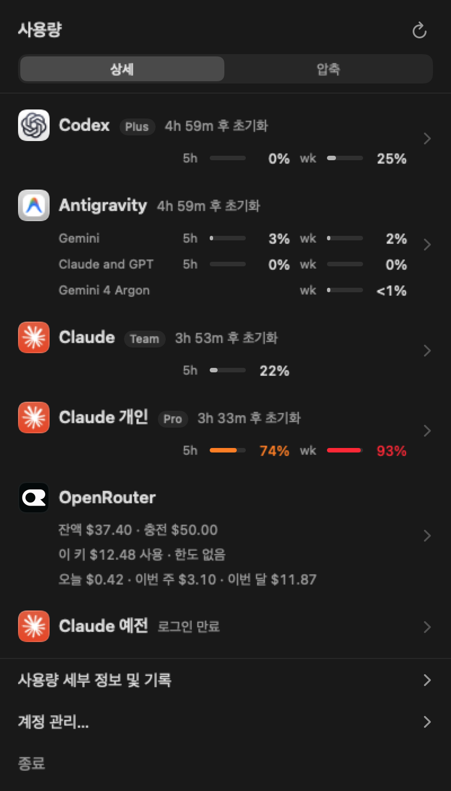

# TokenMonitor

AI 코딩 서비스의 사용량을 한곳에서 보여 주는 macOS 메뉴바 앱. Orca의 "사용량" 패널을 따라 만들었다. 메뉴바 아이콘을 누르면 반투명 팝오버가 열리고, 압축/상세 두 가지 보기로 서비스별 사용률과 초기화까지 남은 시간을 보여 준다.

<p align="center">
  
</p>

| 서비스 | 가져오는 방법 | 표시 |
|---|---|---|
| ChatGPT Codex | `codex app-server` (JSON-RPC, `account/rateLimits/read`) | 5시간·주간 사용률 |
| Claude (여러 계정) | Claude Code가 키체인에 저장한 토큰으로 `api.anthropic.com/api/oauth/usage` 조회 | 세션·주간 사용률 |
| Antigravity | `agy -p /usage --output-format json` (검증한 버전에서만 실행) | 모델 그룹별 5시간·주간 사용률 |
| OpenRouter | 일반 API 키로 `/api/v1/key`, `/api/v1/credits` 조회 | 남은 크레딧, 키 사용액 |

## 요구 사항

- macOS 26 이상, Apple Silicon
- Swift 6.2 이상 (Xcode 없이 Command Line Tools만으로 빌드된다)
- 각 서비스의 CLI가 로그인된 상태: `codex`, `claude`, `agy`

## 빌드와 설치

```bash
make install   # 릴리스 빌드 → build/TokenMonitor.app 조립·ad-hoc 서명 → ~/Applications에 설치
make dev       # 설치 후 실행
```

## 설정

메뉴바 아이콘을 오른쪽 클릭하거나 팝오버 아래의 "계정 관리…"로 설정 창을 연다.

- **Claude 계정 추가**: Claude Code 설정 폴더를 고른다. 두 번째 계정은 별도 폴더로 로그인해 둔다.
  ```bash
  CLAUDE_CONFIG_DIR="$HOME/.claude-account2" claude   # 실행 후 /login
  ```
  앱은 토큰을 갱신하지 않는다. 토큰이 만료되면 "로그인 만료"로 표시되며, 그 폴더로 Claude Code를 한 번 실행하면 다시 조회된다.
- **OpenRouter 키**: 설정 창에 입력하거나 터미널에서 저장한다.
  ```bash
  ~/Applications/TokenMonitor.app/Contents/MacOS/TokenMonitor --set-openrouter-key
  ```
- **로그인 시 자동 실행**, **메뉴바에 가장 높은 사용률 표시**도 설정 창에서 켠다.

## 데이터와 보안

- 계정 목록과 마지막 사용량: `~/Library/Application Support/TokenMonitor/` (`accounts.json`, `cache.json`). 토큰은 저장하지 않는다.
- OpenRouter 키: 키체인 항목 `com.heeseok.tokenmonitor` / `openrouter-api-key`. 키는 화면에 다시 표시하지 않는다.
- Claude 토큰은 Claude Code의 키체인 항목에서 읽기만 하고, 갱신하거나 다시 쓰지 않는다.
- 갱신 기록은 unified log에 남는다(계정 id, 성공·실패 종류만). `make log`로 최근 하루치를 본다.

## 개발

```bash
make test                                    # swift-testing 테스트 (CLT에서는 swift test 대신 실행 파일로 돌린다)
make fetch                                   # 설치된 앱으로 모든 계정을 한 번 조회해 출력
swift run TokenMonitor --render-snapshots /tmp/snaps   # 데모 데이터로 팝오버·설정 창 PNG 렌더링
swift run TokenMonitor --demo                # 데모 데이터로 앱 실행
```

설계와 진행 기록은 [PLAN.md](PLAN.md)에 있다.

## 라이선스

[MIT](LICENSE). 단, OpenRouter 아이콘(`Sources/TokenMonitor/Resources/openrouter.png`)은 openrouter.ai 파비콘이며 상표권은 OpenRouter에 있어 이 라이선스에 포함되지 않는다. 다른 서비스 아이콘은 저장소에 없고, 설치된 각 앱에서 실행 시점에 가져온다.
